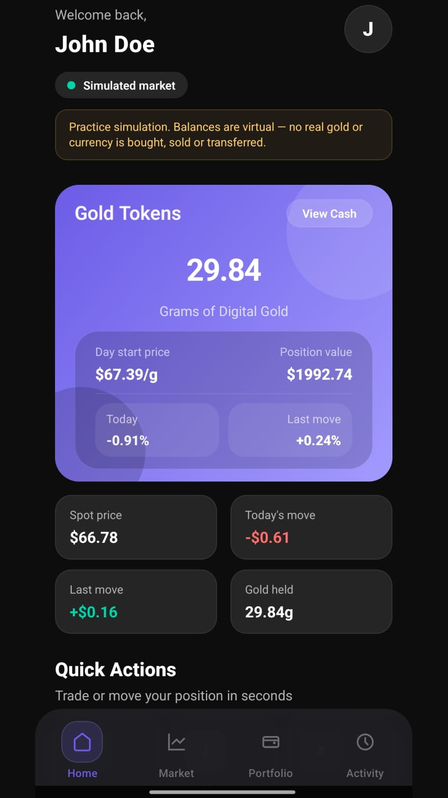
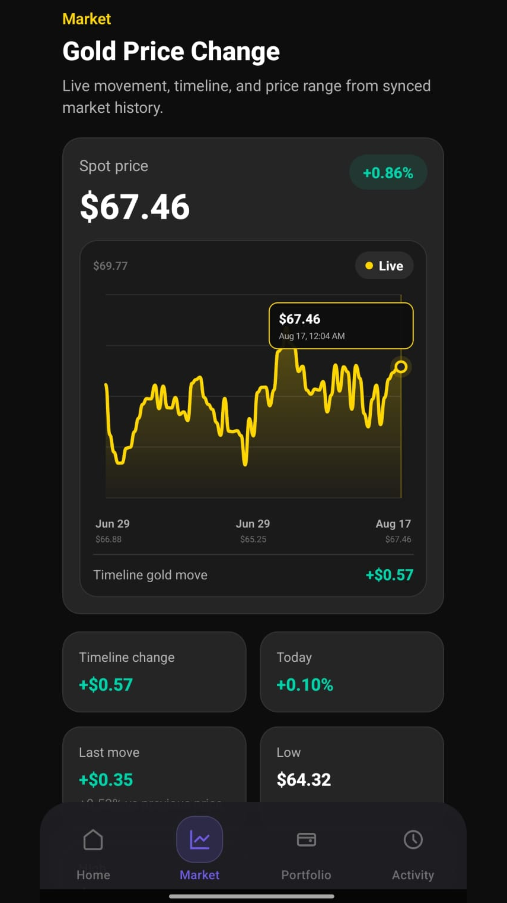
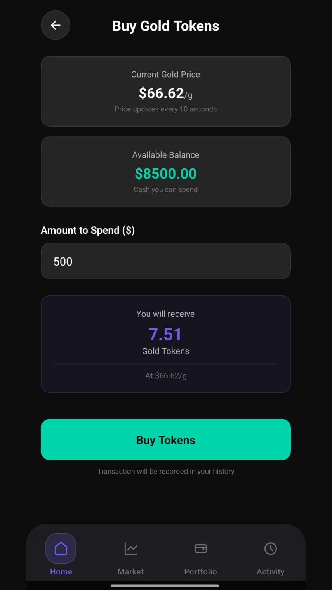
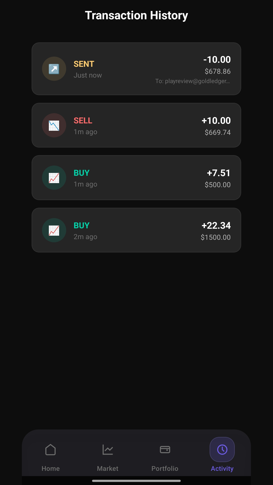

# Gold Ledger: Trading Sim

Gold Ledger is an Android trading simulator. People use it to practice buying, selling, and transferring gold tokens with virtual money. Balances, prices, and trades stay inside the simulation. The app does not take deposits, process withdrawals, or move real gold, currency, or cryptocurrency.

The shipped Android application is published on Google Play as **Gold Ledger: Trading Sim**. The launcher name on the device is **Gold Ledger**. Package name: `com.goldtokenapp`.

This repository is the release source for an inherited client application. Muhammad prepared it for production: release audit, account deletion, legal pages, Android upload signing, store assets, and end-to-end testing before publication. He did not originally build the whole application. See [Ownership and contributions](#ownership-and-contributions) and [`docs/CASE_STUDY.md`](docs/CASE_STUDY.md).

## Features

Implemented behavior in this source tree:

- **Email and password authentication** with Firebase Authentication. Signup creates a Firestore user document and starts the account with 10,000 virtual cash and 0 gold tokens.
- **Simulated gold market.** Each open dashboard generates a local price about every 10 seconds and writes the shared market document about every 60 seconds. The price is clamped between 50 and 100 and is not a live bullion feed.
- **Buy and sell.** Cash is exchanged for tokens, or tokens for cash, at the current simulated price. Each action updates the user document and appends a transaction.
- **Transfers.** A user can send tokens to another account by email. The balance change for both people runs in one Firestore transaction.
- **Portfolio.** The dashboard shows cash, gold holdings, allocation, and profit or loss against the tracked starting value.
- **Charts.** The Market tab reads up to 72 stored price points. The Portfolio tab plots the current cash and token balances against that price history. It is a price-sensitivity view, not a reconstruction of past account balances.
- **Transaction history.** The Activity tab loads the latest 50 transactions and listens for newer ones. Buy, sell, sent transfer, and received transfer are shown.
- **Emergency virtual top-up.** The profile drawer can add 10,000 virtual cash on request. The code does not impose a cooldown.
- **Account deletion.** From the profile drawer, the signed-in user re-enters their password. The app deletes that user's transaction documents, deletes the user document, deletes the Firebase Auth user, and clears the on-device Redux Persist cache.
- **Legal links.** Signup and the profile drawer open the public privacy policy and account-deletion page.

The profile drawer and signup screen state that the product is a simulation.

## Technology stack

Verified from this repository:

| Area | Choice |
| --- | --- |
| App | React Native 0.81.5, React 19.1.0, TypeScript 5.8 |
| Navigation | React Navigation 7 native stacks and bottom tabs |
| State | Redux Toolkit 2 and Redux Persist 6, stored with AsyncStorage |
| Backend | Firebase Authentication and Cloud Firestore through `@react-native-firebase` 22.4.0 |
| Charts and UI | `react-native-svg`, `react-native-gifted-charts`, `react-native-linear-gradient`, `react-native-responsive-screen` |
| Android | Gradle 8.14.3, compileSdk 36, minSdk 24, targetSdk 36, Hermes, New Architecture enabled |
| Package manager | Yarn 4.14.1 (`package.json` `packageManager`). `yarn.lock` and `package-lock.json` are both in the tree |
| Website | Static HTML in `web/`, deployed at the Vercel URL below |
| Tests | Jest 29. The checked-in suite does not currently run; see [Testing](#testing) |

There is no payment SDK in `package.json`. There is no Firebase Admin SDK and no Cloud Functions package in this repository.

## Architecture

```text
App.tsx                         Redux Provider, PersistGate, startup
src/navigation/AppNavigator.tsx Auth stack or main tabs
src/screens/                    Login, signup, dashboard, buy, sell, transfer, charts, history
src/components/                 Profile drawer, inputs, charts, balance card
src/store/store.ts              Persisted root reducer
src/store/slices/               auth, wallet, transactions
src/services/walletService.ts   Firestore wallet, transfer transaction, history
src/services/priceService.ts    Local price generation and market sync
src/config/links.ts             Public privacy and deletion URLs
src/theme/                      Colors, type, spacing
android/                        Application id com.goldtokenapp, versionCode 2, versionName 1.0
web/                            Support site, privacy policy, account-deletion page
store-assets/                   Play listing copy, icon, feature graphic, screenshots
```

`@react-navigation/drawer` is installed. The profile UI is not that navigator. It is the custom `ProfileDrawer` opened from the dashboard.

### Startup and navigation

`App.tsx` dispatches `initializeWallet()` and `checkAuthState()` together, then shows a loading view until both settle. `AppNavigator` renders the login/signup stack when `auth.isAuthenticated` is false and the main tabs when it is true.

Authenticated tabs:

- **Home** — dashboard, buy, sell, transfer
- **Market** — gold price chart
- **Portfolio** — portfolio chart
- **Activity** — transaction history

Redux Persist writes `auth`, `wallet`, and `transactions` to AsyncStorage.

### Data flow

Screens dispatch thunks. Wallet and price thunks call `walletService` and `priceService`, which talk to Firestore. Auth thunks call Firebase Auth directly. Successful thunks write the resulting balances or user into Redux. The dashboard also subscribes to the signed-in user's Firestore document so later writes show up without a manual refresh.

Firestore shape used by the client:

```text
users/{uid}
  name, email, uid, cashBalance, tokenBalance, updatedAt?
  transactions/{id}
    type: BUY | SELL | TRANSFER
    tokens, pricePerToken, totalValue, timestamp
    senderId?, receiverId?, receiverEmail?   # receiverEmail is stored on the sender's copy

market/gold
  price, timestamp, lastSyncSource
market/gold/history/{id}
  price, timestamp
```

Buy and sell calculate the next balances from Redux state, then perform two separate Firestore writes (wallet document, then transaction document). They are not a single Firestore transaction. Transfers are. The transfer path looks up the recipient twice by email, then `transferTokensAtomic()` reads both user documents, checks the sender balance, updates both token balances, and writes both transaction documents.

Every active dashboard runs the price loop. Clients are not read-only subscribers of a backend-owned price.

### Account deletion

`deleteAccount` in `src/store/slices/authSlice.ts` runs in this order:

1. Reauthenticate with the email and the password just entered. Sessions restored by Redux Persist are often too old for Firebase to accept `user.delete()` without this step.
2. Page through `users/{uid}/transactions` in batches of up to 400 and delete each batch. Firestore does not delete subcollections when the parent document is deleted.
3. Delete `users/{uid}`.
4. Delete the Firebase Auth user.
5. On success, `ProfileDrawer` calls `persistor.purge()` so the deleted user's cached wallet is not restored on the next launch.

Documents in other users' transaction history are not deleted. A transfer writes a copy onto both accounts. The other person's copy can still contain the deleted user's id and, on the sender's original copy, the recipient email. Shared `market/gold` data is not user-owned and is not deleted.

The public deletion page describes the same in-app steps and an email fallback for someone who can no longer sign in. That fallback is a support process. It is not a second code path in the app.

Firestore security rules are not in this repository. The client deletes and updates documents as the signed-in user, so those rules have to allow that. They were not reviewed from this source tree.

## Local development

### Prerequisites

- Node.js 20 or newer. This workspace was checked with Node 24.13.0.
- Yarn 4.14.1, as declared in `package.json`.
- Android SDK with compileSdk 36 and build-tools matching the Android project.
- A Firebase project the app is allowed to use, with Email/Password auth and Cloud Firestore.

The Android SDK path belongs in `android/local.properties` as `sdk.dir`. That file is gitignored.

### Install and run

```sh
yarn install
yarn start
yarn android
```

`google-services.json` is the Android Firebase **client** config and is required for the app to initialize. It is not a Firebase Admin private key. `ios/GoogleService-Info.plist` is the matching iOS client config.

The iOS Xcode project still has the React Native template bundle identifier (`org.reactjs.native.example.$(PRODUCT_NAME)`). The published product is the Android app. An iOS build was not part of the Play release and was not run for this repository preparation.

### Release signing properties

Release signing does not store the upload keystore or its passwords in this repository. `android/app/build.gradle` reads these properties when they exist, normally from `~/.gradle/gradle.properties` on the build machine:

```properties
GOLD_LEDGER_UPLOAD_STORE_FILE=/absolute/path/to/upload-keystore.jks
GOLD_LEDGER_UPLOAD_STORE_PASSWORD=<store-password>
GOLD_LEDGER_UPLOAD_KEY_ALIAS=<key-alias>
GOLD_LEDGER_UPLOAD_KEY_PASSWORD=<key-password>
```

If those properties are missing, Gradle still configures the project and the release build is unsigned. Do not commit the keystore, a copy of those values, or `android/local.properties`.

The debug keystore at `android/app/debug.keystore` is the standard React Native debug key. Its debug passwords are the public Android debug defaults. It is not the Play upload key.

## Release builds

From a machine that has the upload-signing properties above:

```sh
cd android
./gradlew assembleRelease
./gradlew bundleRelease
```

The release identity in `android/app/build.gradle` is:

- `applicationId` `com.goldtokenapp`
- `versionCode` 2
- `versionName` 1.0
- `minSdk` 24
- `targetSdk` 36

`android/app/src/main/AndroidManifest.xml` sets `android:allowBackup="false"` and requests only `INTERNET`.

A release APK and AAB were already in `dist/` when this repository was prepared (`GoldLedger-v1.0-vc2.apk` and `GoldLedger-v1.0-vc2.aab`). They are gitignored. The APK's badging reports `versionCode='2'`, `versionName='1.0'`, `com.goldtokenapp`, minSdk 24, and targetSdk 36. Those files match the Gradle `outputs/apk/release` and `outputs/bundle/release` artifacts in this workspace by SHA-256. They were not rebuilt during repository preparation, and they were not byte-compared with the binary Google Play is serving.

Play listing text, the 512 px icon, the 1024×500 feature graphic, and screenshots are in `store-assets/`.

## Testing

Automated checks run while preparing this repository, on the source as it already was. No application code was changed to clear them.

| Check | Result |
| --- | --- |
| `npx tsc --noEmit` | Failed. Pre-existing type errors in `Input.tsx`, `DashboardScreen.tsx`, `HistoryScreen.tsx`, `priceService.ts`, `store.ts`, and `types/index.ts`. |
| `npx jest --ci --watchAll=false --watchman=false` | Failed before any test ran. `__tests__/App.test.tsx` imports `App`, and Jest could not parse the `react-redux` ESM build. |
| `yarn lint` (`eslint .`) | Exited 0. Three pre-existing `react-native/no-inline-styles` warnings in `BuyScreen.tsx`, `SellScreen.tsx`, and `TransferScreen.tsx`. No lint errors. |

Those commands do not prove the Play build. Muhammad personally tested the finished Android application end to end before release. That was manual product testing, not a green automated suite. This repository does not contain a written test log or device recording of that pass.

## Screenshots

Store screenshots use demonstration accounts (John Doe, and Play review addresses on `goldledger.com` / `goldledger.app`). They are not customer records.



*Dashboard. Virtual holdings, with an on-screen notice that no real gold or currency is traded.*



*Market chart built from the app's synced price history.*



*Buy screen. The quote uses the current simulated price.*



*Activity. Simulated buys, sells, and transfers.*

The rest of the listing set, including sell, transfer, portfolio, the feature graphic, and the 512 px icon, is in `store-assets/`.

## Live links

- Google Play: [Gold Ledger: Trading Sim](https://play.google.com/store/apps/details?id=com.goldtokenapp)
- Website, privacy policy, and account deletion: [goldledger-lilac.vercel.app](https://goldledger-lilac.vercel.app/)
- Source repository: [github.com/izeeshanshabbir/gold-ledger](https://github.com/izeeshanshabbir/gold-ledger)

The Play listing was checked while this repository was prepared. It is live under the developer name **ahsanrao**, updated on 10 September 2026, and the public description matches `store-assets/full-description.txt`. The listing shows version name 1.0 through store metadata that lines up with this project. `versionCode` 2 was not visible on the public listing, and the Play binary itself was not downloaded, so this source tree is not proven byte-for-byte identical to the artifact on Play.

## Ownership and contributions

Gold Ledger is a client application that was handed over for release preparation and Google Play deployment. The trading flows, Firebase data model, navigation, and most of the UI were already in that codebase.

Muhammad's release work, as distinguished from that inherited application, is:

- Auditing release blockers against the inherited source
- Implementing in-app account deletion and wiring it through the profile drawer
- Adding the public privacy policy, account-deletion page, and in-app links required by Google Play
- Configuring Android release signing so the upload key stays outside the repository
- Preparing the Play listing copy, icon, feature graphic, and screenshots
- Testing the completed application end to end and carrying it through Play publication

The privacy policy and website name **Ahsan Rao** as the publisher. That is the published client identity. It is not a claim that Muhammad authored the original product.

Further write-ups:

- [Engineering case study](docs/CASE_STUDY.md)
- [Technical reference](docs/PROJECT_CONTEXT.md)
- [Résumé bullets](docs/RESUME_BULLETS.md)
- [Portfolio summary](docs/PORTFOLIO_SUMMARY.md)
